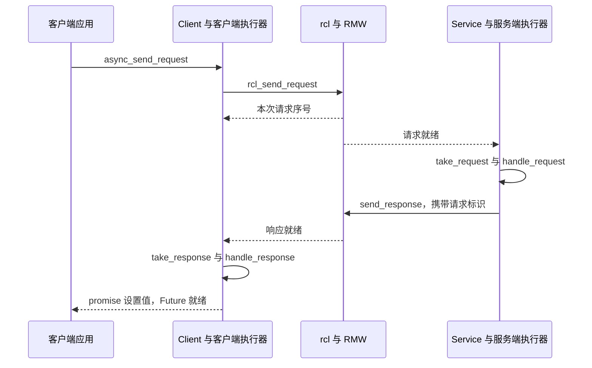

# 第 12 章 Service 与 Client

一次服务调用看起来像普通函数：输入两个整数，返回它们的和。但调用者与被调用者可能分处两个进程；请求发送、服务回调、响应接收和 Future 完成发生在不同时间。本章沿这四个阶段解释为什么“服务器已经回答”还不能保证应用的 Future 已经就绪。

> 状态：初稿，关键入口按本地源码核验；实验待执行。源码基线见 [附录 A](appendix-a-source-baseline.md)。实验使用 Ubuntu、Bash 和本书源码构建环境，固定 `ROS_DOMAIN_ID=42`、`RMW_IMPLEMENTATION=rmw_fastrtps_cpp`。

## 12.1 从最小服务建立问题

示例是 [`add_two_ints_client.cpp`](../../src/ros2/demos/demo_nodes_cpp/src/services/add_two_ints_client.cpp) 和同目录的 [`add_two_ints_server.cpp`](../../src/ros2/demos/demo_nodes_cpp/src/services/add_two_ints_server.cpp)。客户端填入 `a=2`、`b=3`，调用 `async_send_request()`，然后使用 `spin_until_future_complete()` 等待结果。

这里要回答三个问题：框架怎样关联请求与响应？谁设置 Future 的值？如果等待超时，该清理什么？阅读前先掌握第 6 章的端点创建和第 9 章的执行器、回调组。

## 12.2 两个方向，各有一次执行器调度



图适用于普通请求响应路径，省略发现和序列化。服务端使用请求头发送响应；客户端用响应头中的序号寻找本地待完成记录。序号用于关联，不应解释成应用层的全局事务编号。

| 步骤 | 文件与符号 | 职责 |
| --- | --- | --- |
| 创建 | [`create_client.hpp`](../../src/ros2/rclcpp/rclcpp/include/rclcpp/create_client.hpp)、[`create_service.hpp`](../../src/ros2/rclcpp/rclcpp/include/rclcpp/create_service.hpp) | 连接节点接口与端点 |
| 发送与登记 | [`client.hpp`](../../src/ros2/rclcpp/rclcpp/include/rclcpp/client.hpp)，`async_send_request_impl` | 发送请求并登记 promise 或回调 |
| 服务处理 | [`service.hpp`](../../src/ros2/rclcpp/rclcpp/include/rclcpp/service.hpp)，`handle_request` | 分派服务回调并按回调形式处理响应 |
| 就绪执行 | [`executor.cpp`](../../src/ros2/rclcpp/rclcpp/src/rclcpp/executor.cpp)，`execute_service`、`execute_client` | take 后调用对应处理函数 |
| C 层 | [`client.c`](../../src/ros2/rcl/rcl/src/rcl/client.c)、[`service.c`](../../src/ros2/rcl/rcl/src/rcl/service.c) | 转交 RMW 请求响应接口 |

以上文件的提交归属见附录 A 的 `ros2/rclcpp`、`ros2/rcl` 条目。

## 12.3 pending_requests 是 Future 的桥梁

本地 `Client` 保存一个按请求序号索引的 `pending_requests_`。记录包含发送时间和一组类型擦除后的完成信息；不同重载分别保存 promise、响应回调，或请求与响应组合回调。

`async_send_request_impl()` 在互斥锁内调用 `rcl_send_request()`，取得序号，再登记记录。这个锁也用于响应查找，避免接收线程在发送登记尚未完成时检查映射。发送错误抛异常，不能把失败当成一个正常等待中的 Future。

`Executor::execute_client()` 创建响应对象和请求头，调用 take，成功后进入 `Client::handle_response()`。后者通过 `get_and_erase_pending_request()` 取出记录并从映射删除，然后设置 promise，必要时执行用户回调。响应已经抵达中间件而客户端执行器没有继续运行时，这一步仍不会发生。

`future.wait()` 只等待共享状态；它本身不会从 ROS 端点取出响应。示例使用 `spin_until_future_complete()` 的意义，就是在等待期间推进执行器。节点已经属于正在运行的执行器时，不应再临时把它交给另一个执行器；在回调内嵌套 spin 也不能作为通用解法。

## 12.4 可发现不等于请求完成

`wait_for_service()` 检查服务是否可用，解决的是发送前的发现条件。它不能证明后续请求一定收到回答。服务回调阻塞、进程退出、网络异常以及客户端没有调度，都会让完成时间与发现时间分离。

超时同样只说明本地等待到期。它不撤销服务器工作，也不保证服务器尚未执行。客户端可以调用 `remove_pending_request()` 或按时间清理待完成记录；迟到响应若找不到记录，会被忽略。清理可能让尚未完成的 Future 失去 promise，应用不应继续把它当正常响应等待。

需要重试时，必须另外设计幂等性。对“把库存减一”这样的操作，重新发送不是简单的通信恢复；第一次调用可能已经成功，只是回答丢失。

## 12.5 实验：让服务端运行而客户端停止调度

每个终端先执行，路径替换为本书源码构建工作区：

```bash
source /path/to/ros2_source_code/install/setup.bash
export ROS_DOMAIN_ID=42
export RMW_IMPLEMENTATION=rmw_fastrtps_cpp
mkdir -p experiment-results
```

终端 A：

```bash
ros2 run demo_nodes_cpp add_two_ints_server 2>&1 | tee experiment-results/ch12-server.log
```

终端 B：

```bash
ros2 run demo_nodes_cpp add_two_ints_client 2>&1 | tee experiment-results/ch12-client.log
```

预期而非实测：客户端输出结果 5。再停止服务器，重新启动客户端，预期出现等待服务的日志；启动服务器后继续完成。这只能验证发现等待和基本往返。

要区分“已发送”与“已完成”，在带调试符号的客户端可执行文件中设置 `rcl_send_request` 与 `rclcpp::Executor::execute_client` 断点。GDB 默认 all-stop，断点命中时暂停该进程所有线程；服务器在另一个进程继续运行。越过发送函数后暂停客户端，核对服务器日志，再恢复客户端，保存 `execute_client` 命中时的调用栈。模板函数若没有符号，使用匹配源码行断点。不要把暂停期间 Future 未完成归因于网络丢包。

| 实验 | 状态 | 实际观察 | 证据 |
| --- | --- | --- | --- |
| 基本往返与发现等待 | 待执行 | 待填写 | `experiment-results/ch12-*.log` |
| 发送后暂停客户端 | 待执行 | 待填写 | 待保存 GDB 栈与服务端日志 |

## 12.6 回调组与超时边界

如果一个互斥组的回调同步等待同组 Client 的响应处理，这个组在等待期间仍被占用。增加执行器线程数并不能解除组的互斥限制。优先把处理拆成异步发送和完成回调；确需同步等待时，应同时核对线程供给、回调组划分和对象存活期。

服务接口提供请求响应关联，不提供应用事务、工作撤销或自动重试策略。本章把 Future 与执行器连接起来；下一章在此基础上增加目标状态、反馈和取消。

审校记录：调用入口和 pending 映射已核对；实验、具体 RMW 服务传输细节与故障注入结果待验证。
