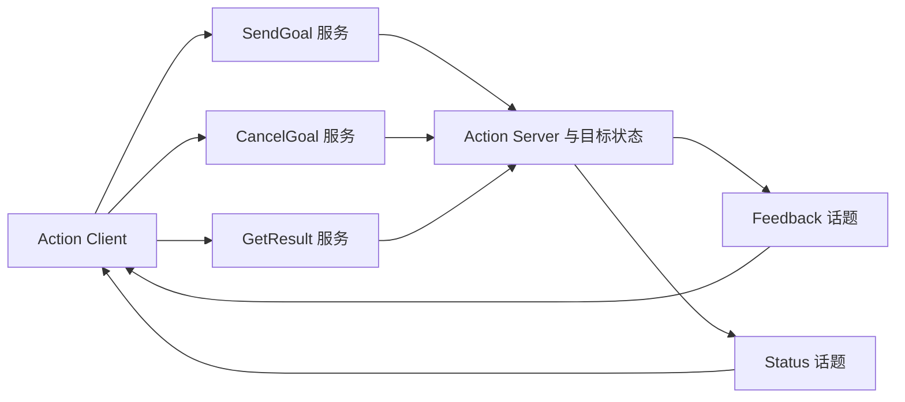

# 第 13 章 Action：目标、反馈、结果与取消

服务适合一次请求与一次响应。导航、轨迹执行等任务还需要报告进度、接受取消，并让调用者区分“目标已接收”和“任务已完成”。Action 将这些需求组织成一套带目标标识的协议。

> 状态：初稿，关键入口按本地源码核验；实验待执行。固定源码版本见 [附录 A](appendix-a-source-baseline.md)，主要涉及 `ros2/rclcpp`、`ros2/rcl`、`ros2/demos`。

## 13.1 从 Fibonacci 看三种回调

示例见 [`fibonacci_action_server.cpp`](../../src/ros2/demos/action_tutorials/action_tutorials_cpp/src/fibonacci_action_server.cpp) 和 [`fibonacci_action_client.cpp`](../../src/ros2/demos/action_tutorials/action_tutorials_cpp/src/fibonacci_action_client.cpp)。接口见 [`Fibonacci.action`](../../src/ros2/demos/action_tutorials/action_tutorials_interfaces/action/Fibonacci.action)。三个区段定义目标、结果与反馈，不应把它们理解成三个互不相关的话题。

服务端注册目标判断、取消判断和接受后处理三个回调。接受目标只是承诺接管该目标；真正计算可以稍后开始。客户端发送目标所得的完成通知与取得最终结果的完成通知也是两个阶段。

## 13.2 三个服务、两个话题与一个状态机



这是协议实体关系图，不是一次调用的严格时间顺序。底层名称通常位于动作名的 `/_action/` 下，属于隐藏实体。第 12 章的请求响应机制承担目标提交、取消与取结果；发布订阅承担反馈和状态分发。

| 文件与符号 | 阅读目标 |
| --- | --- |
| [`server.hpp`](../../src/ros2/rclcpp/rclcpp_action/include/rclcpp_action/server.hpp)，`Server` | 类型化目标回调与 GoalHandle |
| [`server.cpp`](../../src/ros2/rclcpp/rclcpp_action/src/server.cpp)，`ServerBase::take_data`、`execute` | Waitable 就绪事件的取出与分派 |
| [`client.hpp`](../../src/ros2/rclcpp/rclcpp_action/include/rclcpp_action/client.hpp)，`async_send_goal` | 目标提交、反馈与结果回调选项 |
| [`client.cpp`](../../src/ros2/rclcpp/rclcpp_action/src/client.cpp)，`ClientBase` | 序号关联和多种响应处理 |
| [`action_server.c`](../../src/ros2/rcl/rcl_action/src/rcl_action/action_server.c) | C 层动作服务器和目标管理 |

## 13.3 为什么 Action 被视为 Waitable

Action 包含多个底层实体，执行器不能把它当成一条普通订阅。`ServerBase` 将它们加入 wait set，检查目标、结果、取消请求以及过期事件是否就绪，通过 `take_data()` 提取对应数据，再由 `execute()` 分派。

这样第 9 章的调度模型仍能成立：执行器调度一个 Waitable，Waitable 内部再区分协议事件。它没有使用户计算自动并行，也没有为每个目标隐式提供专属线程。

Fibonacci 示例的接受回调启动并 detach 一个线程，是示例自身的选择。工程中应另外管理工作线程、节点关闭与目标句柄生命周期：后台线程不能继续访问已经销毁的节点，也不应让多个目标无界地创建线程。回调组约束作用于执行器回调，不能自动约束用户创建的所有线程。

## 13.4 取消是协作过程

取消请求先经过目标筛选和用户取消回调。接受取消后，目标进入取消过程；工作代码仍要检查 `is_canceling()`，停止实际工作，并用 `canceled(result)` 结束目标。

因此 CancelGoal 响应不是线程被强制终止的证据。若工作代码长时间阻塞或没有检查取消状态，取消可以被接受而任务继续耗时。成功、终止和取消也是不同终态，应分别使用对应 GoalHandle 接口，避免重复结束一个目标。

结果可能在客户端请求结果之前产生，也可能在请求之后产生。服务端需要暂存结果或待回复的结果请求，再在终态形成时关联它们；本地 `execute_result_request_received()` 和结果发布路径可用于追踪。结果保存受过期策略影响，不能无限期依赖服务器保存历史任务。

## 13.5 实验：区分接受、反馈和终态

Ubuntu、Bash，每个终端先加载本书工作区并设置相同域和 RMW：

```bash
source /path/to/ros2_source_code/install/setup.bash
export ROS_DOMAIN_ID=42
export RMW_IMPLEMENTATION=rmw_fastrtps_cpp
mkdir -p experiment-results
```

终端 A：

```bash
ros2 run action_tutorials_cpp fibonacci_action_server 2>&1 | tee experiment-results/ch13-server.log
```

终端 B：

```bash
ros2 action list -t
ros2 action info /fibonacci
ros2 action send_goal /fibonacci action_tutorials_interfaces/action/Fibonacci '{order: 10}' --feedback 2>&1 | tee experiment-results/ch13-goal.log
```

预期而非实测：先报告目标被接受，随后收到多次反馈，最后报告成功状态和序列。输出字段与日志时间不应预填成实测值。用 `order: 9001` 再提交，依据示例拒绝大于 9000 的目标判断，预期目标被拒绝；被拒绝目标不应被当成一次成功执行。

取消实验应使用客户端的 `async_cancel_goal()`，或基于该 API 单独编写客户端。这里不把终止 CLI 进程当成取消操作，也不假设当前 CLI 提供取消子命令。可以在服务器 `handle_cancel`、工作线程 `is_canceling()` 分支、`canceled()` 处设置匹配源码断点，先确认请求是否被接受，再确认工作何时停止。GDB all-stop 会暂停包括工作线程在内的整个服务器；暂停时客户端超时不代表取消协议错误。

| 实验 | 状态 | 实际观察与证据 |
| --- | --- | --- |
| 接受、反馈、结果 | 待执行 | 待填写；`experiment-results/ch13-*.log` |
| 超过上限的目标拒绝 | 待执行 | 待填写；另存拒绝日志 |

取消路径本轮只做源码分析，尚未提供和运行取消探针。它不能列入已完成实验。

## 13.6 本章小结

Action 在服务与话题之上增加目标标识、状态管理和结果保存。执行器负责协议事件，应用负责长任务的调度与取消协作。下一章回到节点自身，研究参数怎样通过服务修改、经校验提交并产生事件。

审校记录：协议实体、Waitable 分派和示例线程已核对；运行观察、取消探针与目标过期实验待补。
