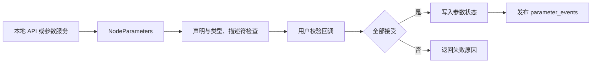

# 第 14 章 参数：声明、校验、服务与事件

参数既是节点内的配置对象，也可以被远端工具查询和修改。理解参数需要把“传入配置”“声明变量”“提交新值”和“观察事件”分开，否则很容易把 YAML 中的一个值当成节点必然已经使用的状态。

> 状态：初稿，按本地 `ros2/rclcpp` 源码核对；实验待执行。提交见 [附录 A](appendix-a-source-baseline.md)。前置知识为第 4 章 NodeOptions 和第 12 章服务。

## 14.1 overrides 与 declaration

NodeOptions、命令行和参数文件可以提供参数覆盖值。覆盖值进入初始化流程，并不意味着每个名字必然成为已声明参数。`automatically_declare_parameters_from_overrides` 控制是否自动声明，`allow_undeclared_parameters` 控制对未声明参数的处理；这两个开关回答不同问题。

默认应用宜主动声明参数并说明类型、范围和只读约束。声明时默认值与覆盖值共同决定初值，读取参数则读取节点保存的状态。应用若只在启动时读取一次并缓存，之后修改参数不会自动改写那份缓存。

## 14.2 一个节点内的提交路径



图描述设置参数的主要检查与提交关系；声明、删除和动态类型参数各有分支。

| 文件与符号 | 职责 |
| --- | --- |
| [`node_parameters.cpp`](../../src/ros2/rclcpp/rclcpp/src/rclcpp/node_interfaces/node_parameters.cpp)，`declare_parameter`、`set_parameters_atomically` | 参数存储、验证和提交 |
| 同文件，`add_on_set_parameters_callback` | 注册用户校验并保存回调句柄 |
| [`parameter_service.cpp`](../../src/ros2/rclcpp/rclcpp/src/rclcpp/parameter_service.cpp)，`ParameterService` | 将远端服务请求转交节点参数接口 |
| [`parameter_client.hpp`](../../src/ros2/rclcpp/rclcpp/include/rclcpp/parameter_client.hpp) | 同步、异步参数客户端 |
| [`parameter_event_handler.hpp`](../../src/ros2/rclcpp/rclcpp/include/rclcpp/parameter_event_handler.hpp) | 监听参数事件 |

## 14.3 原子性止于参数状态

本地 `set_parameters()` 把参数逐项交给设置路径，因此一批参数可能部分成功。`set_parameters_atomically()` 则围绕整批参数做验证，拒绝时不提交这一批参数值。远端也有对应的两类服务。

源码先检查声明、类型和描述符，再调用用户校验逻辑，成功后更新内部状态并发布事件。这里的原子性不等于业务系统的事务：如果校验回调已经修改硬件、写文件或切换算法，后续另一个校验回调拒绝时，这些外部副作用不会自动回滚。

校验回调宜检查输入并返回 `successful` 和 `reason`，避免在校验阶段做不可回滚操作。多个回调存在执行顺序，本地实现把新注册的回调放到容器前端。不能把顺序当成跨版本稳定的业务协议，也不能假设自己的回调总是最后执行。

注册返回的句柄应由节点长期保存。句柄的生命周期影响注册是否仍有效；只调用注册函数而丢弃结果，是参数校验失效时值得首先检查的地方。

## 14.4 服务结果与事件的不同用途

设置服务响应回答本次请求是否成功。`/parameter_events` 发布新增、修改和删除参数的信息，用于观察和协作。事件传输仍受 QoS、发现和调度影响，不是无遗漏的业务审计数据库。

事件消费者应核对完整节点名与参数名，避免把另一个节点的同名参数当成本节点状态。恢复或重新连接时，可以先通过参数服务获取当前值，再把事件用于持续更新；仅凭一条旧事件不能证明此刻仍是该值。

## 14.5 实验：允许未声明参数的黑板

本地 [`parameter_blackboard.cpp`](../../src/ros2/demos/demo_nodes_cpp/src/parameters/parameter_blackboard.cpp) 是用于远端设置的演示节点。它的选项刻意允许未声明参数，适合展示服务，不代表业务节点应普遍采用该配置。

Ubuntu、Bash，每个终端：

```bash
source /path/to/ros2_source_code/install/setup.bash
export ROS_DOMAIN_ID=42
export RMW_IMPLEMENTATION=rmw_fastrtps_cpp
mkdir -p experiment-results
```

终端 A：

```bash
ros2 run demo_nodes_cpp parameter_blackboard
```

终端 B 先监听事件，终端 C 再设置值：

```bash
ros2 topic echo /parameter_events rcl_interfaces/msg/ParameterEvent 2>&1 | tee experiment-results/ch14-events.log
```

```bash
ros2 param list /parameter_blackboard
ros2 param set /parameter_blackboard gain 2.0
ros2 param get /parameter_blackboard gain
ros2 param describe /parameter_blackboard gain
ros2 service call /parameter_blackboard/set_parameters_atomically rcl_interfaces/srv/SetParametersAtomically '{parameters: [{name: gain, value: {type: 3, double_value: 3.0}}]}'
ros2 param get /parameter_blackboard gain
```

预期而非实测：成功设置后，get 分别取得 2.0、3.0，事件包含节点名和对应参数变化。`type: 3` 是接口定义中的双精度类型标记。黑板不带本章讨论的自定义拒绝规则，不能用它证明多回调拒绝和业务回滚行为。

然后在普通 talker 上尝试设置未声明参数，作为默认选项的对照：

```bash
ros2 run demo_nodes_cpp talker
```

```bash
ros2 param set /talker gain 2.0
```

预期而非实测：该名字未声明时设置失败。记录服务结果和错误原因，不要用事件是否到达作为唯一判据。

| 实验 | 状态 | 实际观察 | 证据 |
| --- | --- | --- | --- |
| 黑板设置、读取与事件 | 待执行 | 待填写 | `experiment-results/ch14-events.log`，CLI 输出待保存 |
| 默认节点拒绝未声明参数 | 待执行 | 待填写 | 待保存错误输出 |

## 14.6 本章小结

参数覆盖提供启动输入，声明建立参数契约，设置接口完成验证和提交，服务与事件让外部参与。原子设置保护参数值的一批更新，应用副作用仍由应用负责。下一章将配置和运行分成不同生命周期状态。

审校记录：默认选项、设置与校验入口已核对；拒绝回调探针、事件丢失和并发设置实验待补。
