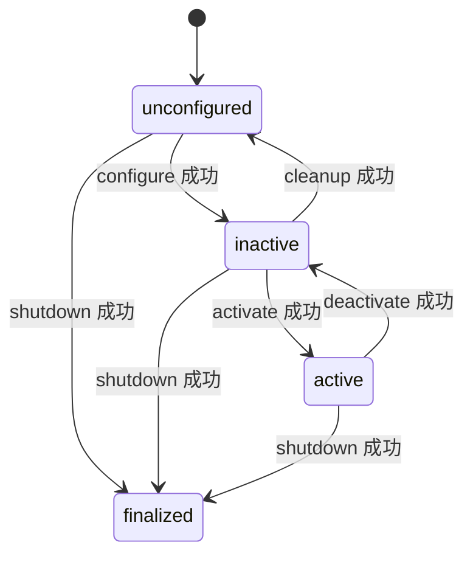

# 第 15 章 生命周期节点：状态转换与资源管理

设备驱动往往需要先读取配置、分配资源，再开始输出数据，最后停止输出并释放资源。普通节点的构造与析构不足以表达所有阶段。生命周期节点把这些阶段变成可查询、可请求转换的状态机。

> 状态：初稿，关键状态转换和示例按本地源码核验；实验待执行。主要仓库为 `ros2/rclcpp`、`ros2/rcl`、`ros2/demos`，版本见 [附录 A](appendix-a-source-baseline.md)。

## 15.1 状态不是线程开关

主要稳定状态是 unconfigured、inactive、active、finalized。configure、activate、deactivate、cleanup、shutdown 等转换连接它们，转换过程中还有 configuring 等过渡状态。



图只画成功路径；失败与错误处理必须沿完整状态机分析。active 描述管理状态，不是执行器线程是否正在运行。inactive 时普通服务、订阅和定时器并不会一律自动停止。

## 15.2 转换先进入过渡状态，再执行用户回调

| 文件与符号 | 作用 |
| --- | --- |
| [`lifecycle_node.cpp`](../../src/ros2/rclcpp/rclcpp_lifecycle/src/lifecycle_node.cpp)，`LifecycleNode` | 公开接口、转换和托管实体管理 |
| [`lifecycle_node_interface_impl.hpp`](../../src/ros2/rclcpp/rclcpp_lifecycle/src/lifecycle_node_interface_impl.hpp)，`change_state`、`execute_callback` | 请求转换、用户回调和完成分支 |
| [`rcl_lifecycle.c`](../../src/ros2/rcl/rcl_lifecycle/src/rcl_lifecycle.c) | C 层状态机触发 |
| [`lifecycle_publisher.hpp`](../../src/ros2/rclcpp/rclcpp_lifecycle/include/rclcpp_lifecycle/lifecycle_publisher.hpp)，`publish` | 检查发布者激活状态 |
| [`lifecycle_talker.cpp`](../../src/ros2/demos/lifecycle/src/lifecycle_talker.cpp) | 配置、激活、停用和释放示例 |

`change_state()` 先根据转换编号触发 C 状态机，再在过渡状态执行已注册回调，将返回码映射到完成转换。SUCCESS、FAILURE、ERROR 含义不同，最终去向取决于当前转换；不能把所有失败都概括成“留在原状态”。异常也会进入错误处理逻辑。

错误处理本身还有返回结果，并据此推进状态机。排障时应同时记录起始状态、请求的转换和回调返回码，而不是只打印一个“失败”。

## 15.3 配置资源与激活资源

示例在 `on_configure()` 中创建发布者和普通定时器，在 `on_activate()` 中调用基类方法激活托管发布者，在 `on_deactivate()` 中停用发布者；cleanup 和 shutdown 释放资源。

普通定时器与生命周期发布者是两类对象。定时器仍可能到期并进入回调，只是 inactive 发布者不向外发布。因此“话题没有消息”不能证明定时器没有运行。工程代码若希望停用时停止采集，应明确取消定时器、暂停工作线程或控制设备状态。

重写激活回调时也要考虑基类对托管实体的处理。如果跳过基类调用且没有手动激活发布者，节点可能进入 active，而发布者仍不输出。节点状态和实体状态需要保持一致。

## 15.4 实验：用 CLI 驱动完整循环

Ubuntu、Bash，每个终端先执行：

```bash
source /path/to/ros2_source_code/install/setup.bash
export ROS_DOMAIN_ID=42
export RMW_IMPLEMENTATION=rmw_fastrtps_cpp
mkdir -p experiment-results
```

终端 A：

```bash
ros2 run lifecycle lifecycle_talker 2>&1 | tee experiment-results/ch15-talker.log
```

终端 B 启动后保持运行：

```bash
ros2 run lifecycle lifecycle_listener 2>&1 | tee experiment-results/ch15-listener.log
```

终端 C 逐条执行，activate 与 deactivate 之间等待数秒观察输出：

```bash
ros2 lifecycle get /lc_talker
ros2 lifecycle set /lc_talker configure
ros2 lifecycle get /lc_talker
ros2 lifecycle set /lc_talker activate
ros2 lifecycle get /lc_talker
ros2 lifecycle set /lc_talker deactivate
ros2 lifecycle set /lc_talker cleanup
ros2 lifecycle get /lc_talker
```

预期而非实测：状态依次经过 unconfigured、inactive、active、inactive，最后回到 unconfigured；active 期间监听端收到消息。再 configure、activate，确认资源可以再次建立。实验结束在各运行终端按 Ctrl+C。

还可以在 unconfigured 状态请求 activate，预期非法转换被拒绝。此实验验证转换合法性，不验证所有 ERROR 分支。若希望证明 inactive 定时器仍运行，需在 publish 回调设置源码断点或加入独立计数；外部监听的沉默不能替代这项证据。

| 实验 | 状态 | 实际观察与证据 |
| --- | --- | --- |
| 配置—激活—停用—清理循环 | 待执行 | 待填写；`experiment-results/ch15-*.log` |
| 非法转换拒绝 | 待执行 | 待填写；CLI 状态输出待保存 |

## 15.5 生命周期与执行器仍相互独立

远端转换通过服务进入节点，仍需要执行器调度。转换回调长时间阻塞，会占用相应线程和回调组。后台工作与清理并发时，应用必须先让工作停止再释放资源，状态机不会替应用 join 所有线程。

生命周期提供管理协议和状态契约；资源的具体创建、激活与释放由回调和托管实体实现。下一章讨论这些节点怎样从共享库被创建，并放入容器执行器。

审校记录：成功路径、回调返回分派与定时器边界已核对；错误处理和设备资源实验待补。
