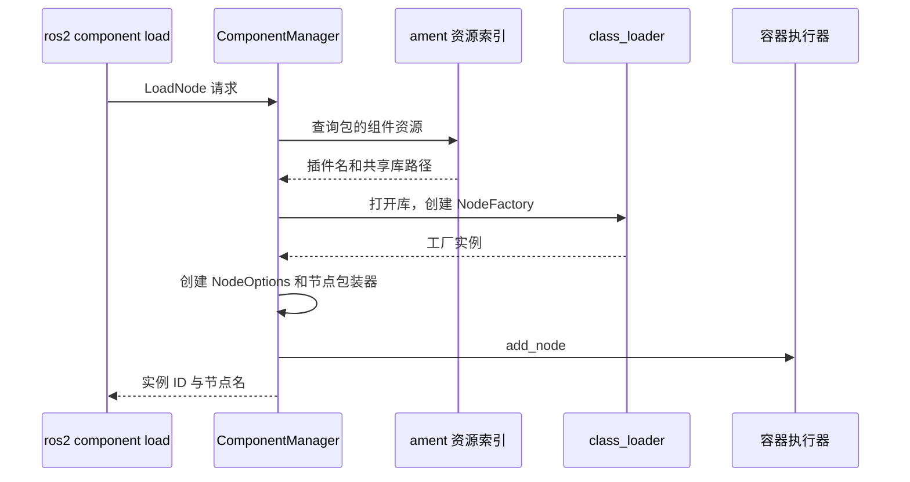

# 第 16 章 组件：注册、插件加载、容器与执行器

同一份 talker 类既可以由 `ros2 run` 启动，也可以被容器动态加载。两种入口并非两套发布逻辑，而是组件工厂与节点类的不同装配方式。本章正面解释 CMake 宏、注册宏、共享库与执行器之间的关系。

> 状态：初稿，按本地 `ros2/rclcpp`、`ros2/demos` 源码核验；实验待执行。固定提交见 [附录 A](appendix-a-source-baseline.md)。前置章节为第 4、9、10 章。

## 16.1 编译期与运行期各有一份注册信息

[`talker.cpp`](../../src/ros2/demos/demo_nodes_cpp/src/topics/talker.cpp) 末尾的 `RCLCPP_COMPONENTS_REGISTER_NODE` 宏注册一个可以构造该节点类的工厂。节点类通常接收 `NodeOptions`，让调用者传入参数、重映射和进程内通信选项。

[`demo_nodes_cpp/CMakeLists.txt`](../../src/ros2/demos/demo_nodes_cpp/CMakeLists.txt) 先把类编进共享库，再使用 `rclcpp_components_register_node()` 声明插件名与独立可执行文件名。C++ 注册让类加载器能找到工厂；ament 资源索引让组件管理器知道应该打开哪一个库。两者缺一，都可能使动态加载失败。

## 16.2 register_node 为什么生成可执行文件

| 文件与符号 | 职责 |
| --- | --- |
| [`register_node_macro.hpp`](../../src/ros2/rclcpp/rclcpp_components/include/rclcpp_components/register_node_macro.hpp) | C++ 工厂注册宏 |
| [`rclcpp_components_register_node.cmake`](../../src/ros2/rclcpp/rclcpp_components/cmake/rclcpp_components_register_node.cmake) | 资源索引条目和独立入口生成 |
| [`node_main.cpp.in`](../../src/ros2/rclcpp/rclcpp_components/src/node_main.cpp.in) | 独立程序的入口模板 |
| [`component_manager.cpp`](../../src/ros2/rclcpp/rclcpp_components/src/component_manager.cpp)，`get_component_resources`、`create_component_factory` | 查索引、加载库并寻找工厂 |
| 同文件，`on_load_node`、`on_unload_node` | 创建、加入执行器和移除实例 |

本地 CMake 宏解析 `PLUGIN`、`EXECUTABLE`、`EXECUTOR`、`RESOURCE_INDEX`。默认执行器是 `SingleThreadedExecutor`。宏记录“插件名;库相对路径”，Windows 使用 bin 路径，其他平台使用 lib 路径；随后配置入口模板，生成源文件并创建可执行目标。

因此 `ros2 run demo_nodes_cpp talker` 最终运行的是生成入口，它通过工厂创建 Talker 并推进执行器。构建目录中的生成文件不是适合手工修改的源文件；需要改变行为时应修改节点、模板或构建配置。

## 16.3 动态加载链



组件管理器既是提供管理服务的节点，也保存已加载实例。节点包装器提供 NodeBaseInterface，管理器据此把实例交给执行器。工厂构造完成不代表用户回调已经开始执行；真正运行仍依赖执行器。

实例 ID 用于卸载该实例，不应与节点名混淆。卸载路径先从执行器移除节点，再删除管理器保存的包装器。用户额外保存的引用、后台线程和库加载器生命周期都会影响最终销毁，不能将卸载服务返回概括成“所有资源立即释放”。

## 16.4 同进程、并发与进程内通信

两个组件进入同一容器，就共享进程。是否并行取决于容器执行器、线程数和回调组；是否走第 10 章的进程内消息路径，取决于各节点选项及消息和 QoS 条件。加载到同一个容器不会自动证明零复制。

`component_container`、`component_container_mt` 等入口表达不同执行器组织方式。组件迁入多线程容器后，原有代码可能暴露并发问题；仍应按第 9 章分析互斥组和共享状态。

## 16.5 实验：同一类的两种入口

Ubuntu、Bash，所有终端加载同一工作区，固定域 42、RMW 为 rmw_fastrtps_cpp：

```bash
source /path/to/ros2_source_code/install/setup.bash
export ROS_DOMAIN_ID=42
export RMW_IMPLEMENTATION=rmw_fastrtps_cpp
mkdir -p experiment-results
```

先用独立入口在两个终端运行 talker、listener，观察通信后停止。再启动容器：

```bash
ros2 run rclcpp_components component_container 2>&1 | tee experiment-results/ch16-container.log
```

另一个终端：

```bash
ros2 component types
ros2 component load /ComponentManager demo_nodes_cpp demo_nodes_cpp::Talker
ros2 component load /ComponentManager demo_nodes_cpp demo_nodes_cpp::Listener
ros2 component list
ros2 node list
```

预期而非实测：组件类型可列出，两个实例加载成功，容器日志同时显示发布和接收。记下 `component list` 的实际实例 ID，再执行 `ros2 component unload /ComponentManager <实际ID>`，不能预设 ID 永远为 1 或 2。

对照独立进程与容器的进程列表，验证它们的进程布局。这个实验只支持加载、卸载与同进程运行的结论；没有记录消息地址、分配次数和执行线程时，不能据此评价复制成本或并发程度。

| 实验 | 状态 | 实际观察与证据 |
| --- | --- | --- |
| 独立入口 | 待执行 | 待填写；终端输出待保存 |
| 组件加载与卸载 | 待执行 | 待填写；`experiment-results/ch16-container.log` 与实例列表 |

## 16.6 本章小结

C++ 注册提供工厂，CMake 注册提供发现信息并可生成独立入口，管理器负责实例装配，执行器负责运行。下一章对照 Python 客户端库，观察同一底层机制怎样暴露为另一套语言接口。

审校记录：宏参数、默认执行器、索引和管理器路径已核对；实际生成文件、动态加载和卸载行为待运行验证。
