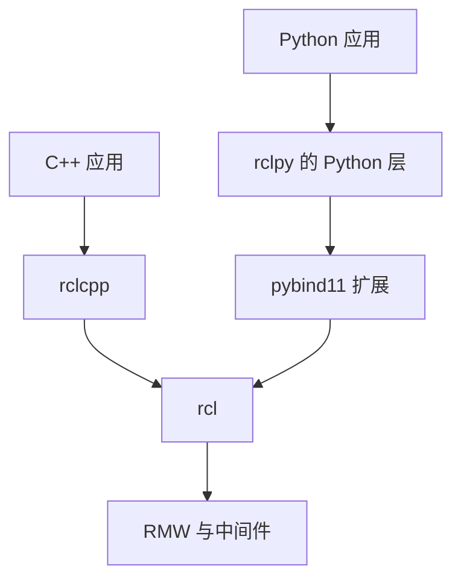

# 第 17 章 rclpy 对照：Python 接口、底层绑定与回调执行

Python 节点可以与 C++ 节点通信，因为双方遵守相同的接口和 RMW 协议。但 rclpy 不以 rclcpp 为底层；它有自己的节点对象、执行器和回调组，通过扩展模块连接 rcl。本章对照两条客户端库路径，解释共用机制与语言差异。

> 状态：初稿，关键路径按本地 `ros2/rclpy` 源码核验；实验待执行。提交见 [附录 A](appendix-a-source-baseline.md)。

## 17.1 两条平行路径



发布订阅的名称、类型和 QoS 仍需要兼容。Python 层对象通常不是 DDS 样本本身；类型转换、序列化和 Python 对象创建不能因为接口看起来简单就被忽略。

| 文件与符号 | 对照目标 |
| --- | --- |
| [`node.py`](../../src/ros2/rclpy/rclpy/rclpy/node.py)，`Node` | 创建实体、保存回调组和 Python 引用 |
| [`executors.py`](../../src/ros2/rclpy/rclpy/rclpy/executors.py)，`_make_handler`、`_execute_client` | 就绪处理、回调组许可和 Future 完成 |
| [`callback_groups.py`](../../src/ros2/rclpy/rclpy/rclpy/callback_groups.py) | 互斥与可重入执行约束 |
| [`client.py`](../../src/ros2/rclpy/rclpy/rclpy/client.py)，`call`、`call_async` | 请求发送、pending 映射和同步等待 |
| [`_rclpy_pybind11.cpp`](../../src/ros2/rclpy/rclpy/src/rclpy/_rclpy_pybind11.cpp) | 扩展模块绑定入口 |
| [`subscription.cpp`](../../src/ros2/rclpy/rclpy/src/rclpy/subscription.cpp) | C 层订阅与 Python 消息转换 |

## 17.2 handler 的开始与结束

执行器找到就绪实体后创建 handler。`_make_handler()` 标记实体已有待处理事件，避免重复排入等待列表；真正处理前调用回调组的 `beginning_execution()`，获得许可后 take 数据并执行回调，最后释放组的执行占用。

`await_or_execute()` 允许某些回调以普通函数或协程形式提供。但出现 `async def` 不等于代码已经在独立 asyncio 应用循环上运行，也不等于所有 await 对象都能直接兼容。应沿 rclpy 的 Task 与 Future 实现核对调度。

普通订阅回调执行时间长，仍可能阻塞同线程其他实体。多线程执行器把工作交给线程池；在通常使用 GIL 的 CPython 环境中，纯 Python CPU 密集计算不会简单地随线程数线性加速。阻塞 I/O 或释放 GIL 的扩展代码需要单独测量。

## 17.3 Python Future 同样需要响应处理

`call_async()` 将请求序号与 Future 登记在 Client 的待完成映射中。`_execute_client()` 根据响应头中的序号取得 Future，关联执行器并调用 `set_result()`。这与第 12 章的 C++ promise 路径相对应。

同步 `call()` 添加完成回调并等待事件。源码明确提示不要在回调中调用它，否则可能死锁。原因仍需结合线程与回调组解释：等待者占住处理响应所需的执行资源，完成事件便无法出现。

异步 API 也不自动消除所有等待问题。若应用发送后忙循环或停止 spin，Future 仍可能无法完成。rclpy 的 pending 清理与 C++ 不是逐行相同的实现，应核对 `remove_pending_request()` 和 Future 完成回调，避免直接套用另一语言的清理方法。

## 17.4 实验：跨语言通信与服务

Ubuntu、Bash，所有终端加载本书源码工作区，固定域和 RMW：

```bash
source /path/to/ros2_source_code/install/setup.bash
export ROS_DOMAIN_ID=42
export RMW_IMPLEMENTATION=rmw_fastrtps_cpp
mkdir -p experiment-results
```

终端 A 和 B 分别运行：

```bash
ros2 run demo_nodes_cpp talker
```

```bash
ros2 run demo_nodes_py listener 2>&1 | tee experiment-results/ch17-listener.log
```

预期而非实测：Python listener 接收 C++ talker 的 String 消息。停止两个进程，再分别运行：

```bash
ros2 run demo_nodes_cpp add_two_ints_server
```

```bash
ros2 run demo_nodes_py add_two_ints_client_async 2>&1 | tee experiment-results/ch17-client.log
```

预期而非实测：Python 客户端得到加法响应。示例请求值以 [`add_two_ints_client_async.py`](../../src/ros2/demos/demo_nodes_py/demo_nodes_py/services/add_two_ints_client_async.py) 为准，不能凭 C++ 示例的值推定所有客户端输出。

对照 Python 源码中发送、spin 和检查 Future 的顺序。如果移除推进执行器的步骤，即使服务端有请求日志，也不能据此推断客户端的 Future 已完成。该对照只做静态阅读，本轮不修改演示源码制造阻塞。

| 实验 | 状态 | 实际观察与证据 |
| --- | --- | --- |
| C++ 发布、Python 接收 | 待执行 | 待填写；`experiment-results/ch17-listener.log` |
| Python 调用 C++ 服务 | 待执行 | 待填写；`experiment-results/ch17-client.log` |

## 17.5 销毁与本章小结

Python 引用计数、垃圾回收和底层实体有效期共同影响对象存活。句柄使用上下文管理保护底层访问，但应用仍应按示例显式停止执行器、销毁节点并关闭 Context，避免把垃圾回收时间当成通信资源释放协议。

rclpy 与 rclcpp 共用 rcl/RMW 边界，执行器和语言对象各自实现。下一章走出节点内部，研究 launch 如何启动和管理进程。

审校记录：绑定入口、handler 与响应完成路径已核对；跨语言运行、线程性能和协程组合实验待验证。
