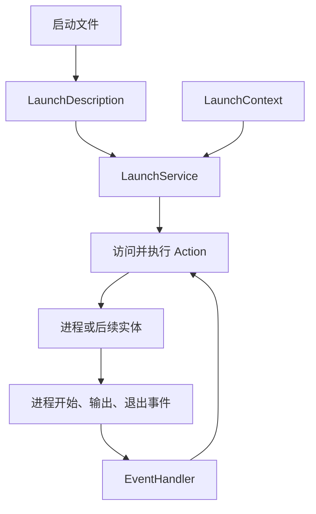

# 第 18 章 launch 与 launch_ros：描述、动作、事件与进程编排

当一个系统包含多个节点，启动脚本还要解决参数、命名空间、退出联动和进程输出。launch 把这些工作组织成描述、动作与事件。理解它的关键是区分“生成启动描述”和“执行启动描述”。

> 状态：初稿，按本地 `ros2/launch`、`ros2/launch_ros` 源码核验；实验待执行。版本见 [附录 A](appendix-a-source-baseline.md)。

## 18.1 描述不是已启动的进程

Python 启动文件的 `generate_launch_description()` 返回 LaunchDescription，其中保存动作。构造 `Node(...)` 时主要是在描述未来执行所需的信息，并不立即创建 ROS 节点或启动进程。

LaunchService 在运行阶段访问实体、推进动作并处理事件；LaunchContext 保存启动配置、局部信息和事件相关状态。LaunchConfiguration 等 substitution 在上下文中求值，因此不能直接把它当作已经展开的 Python 字符串。



## 18.2 Node 动作如何接入普通进程执行

| 文件与符号 | 作用 |
| --- | --- |
| [`launch_service.py`](../../src/ros2/launch/launch/launch/launch_service.py)，`run_async`、`_process_one_event` | 异步事件循环和启动生命周期 |
| [`launch_context.py`](../../src/ros2/launch/launch/launch/launch_context.py)，`LaunchContext` | 配置与运行上下文 |
| [`execute_process.py`](../../src/ros2/launch/launch/launch/actions/execute_process.py)，`ExecuteProcess` | 进程动作 |
| [`node.py`](../../src/ros2/launch_ros/launch_ros/launch_ros/actions/node.py)，`Node.execute` | 展开名称、参数和重映射，委托进程执行 |
| [`load_composable_nodes.py`](../../src/ros2/launch_ros/launch_ros/launch_ros/actions/load_composable_nodes.py) | 向已有容器请求组件加载 |

`launch_ros.actions.Node` 继承 ExecuteProcess。它在执行阶段展开 substitutions，准备 ROS 专用命令行，再交给进程动作。这解释了为什么节点名、命名空间、重映射与参数最终仍要经过第 4 章的初始化解析。

ComposableNode 的描述则由加载动作转换成组件管理请求，和为每个节点创建进程不同。启动文件决定进程布局，节点代码决定内部行为，两者应共同分析。

## 18.3 进程事件不证明业务就绪

进程开始只证明操作系统进程已经启动，不保证 ROS 发现完成、参数验证成功、生命周期配置完成或服务已经可用。需要等待业务就绪时，应选用明确的服务、状态或应用握手。

固定延时可以用于实验安排，但不能证明所有负载下都足够。OnProcessExit 也只说明退出事件出现：处理器应区分正常完成和故障退出，再决定是否 Shutdown、重启或启动后继动作。

## 18.4 实验：退出联动的最小启动文件

新建 [`experiments/launch/book.launch.py`](../../experiments/launch/book.launch.py)，代码见该文件。它启动 talker 和 listener，把 talker 的退出事件连接到整个 launch 的 Shutdown。Python 文件按路径启动，无需另建 ament 包。

Ubuntu、Bash，在仓库根目录执行：

```bash
source /path/to/ros2_source_code/install/setup.bash
export ROS_DOMAIN_ID=42
export RMW_IMPLEMENTATION=rmw_fastrtps_cpp
mkdir -p experiment-results
ros2 launch experiments/launch/book.launch.py 2>&1 | tee experiment-results/ch18-launch.log
```

预期而非实测：两个节点进入 `/book` 命名空间，使用同一重映射话题，listener 收到消息。另一个终端核对：

```bash
ros2 node list
ros2 topic info /book/book_chatter -v
ps -eo pid,args | grep '[d]emo_nodes_cpp'
```

根据实际进程参数确定本次启动的 talker PID，用 `kill -TERM <talker实际PID>` 结束它。预期而非实测：OnProcessExit 触发 Shutdown，listener 随后结束。不要按可执行文件名批量终止其他进程。正常按 Ctrl+C 关闭则验证用户中断路径，应另存记录。

该示例没有判断退出码，因此故意把任意 talker 退出都视为停止整个演示的原因。生产编排需要补充退出码与恢复策略。

| 实验 | 状态 | 实际观察与证据 |
| --- | --- | --- |
| 命名空间与重映射 | 待执行 | 待填写；图查询与 `ch18-launch.log` |
| talker 退出联动 | 待执行 | 待填写；PID、退出事件与后继关闭日志 |

## 18.5 本章小结

launch 描述执行意图，运行上下文完成求值，动作推进操作，事件连接后续行为。它管理进程与编排关系，应用就绪还需要可验证的协议。下一章研究 CLI 的命令扩展与图查询。

审校记录：Node 委托和 LaunchService 事件入口已核对；示例完成 Python 语法检查后仍需 ROS 环境运行。
