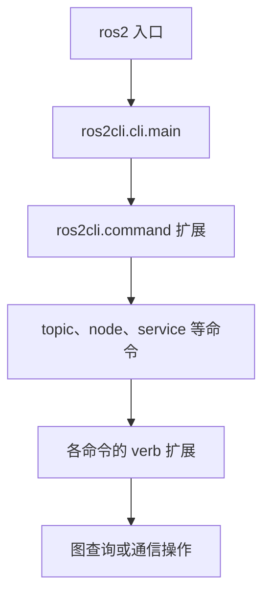

# 第 19 章 ros2cli：命令扩展、图查询与诊断入口

`ros2 topic list`、`ros2 service call` 和 `ros2 bag record` 共用入口，却不是同一种操作。前者读取图，后两者参与通信或启动记录。理解 CLI 的扩展结构与数据来源，有助于判断一个命令究竟证明了什么。

> 状态：初稿，按本地 `ros2/ros2cli` 源码核验；实验待执行。版本见 [附录 A](appendix-a-source-baseline.md)。

## 19.1 命令入口与 verb 扩展



`cli.main()` 构建 argparse 解析器，通过 entry points 按需添加子命令，再调用所选扩展的 `main()`。topic 命令继续加载它自己的 verb 扩展，例如 list、info、echo、pub。安装元数据与环境搜索路径决定哪些扩展可见，不是编辑核心 CLI 文件后命令才会出现。

| 文件与符号 | 阅读问题 |
| --- | --- |
| [`cli.py`](../../src/ros2/ros2cli/ros2cli/ros2cli/cli.py)，`main` | 顶层解析与分派 |
| [`command/__init__.py`](../../src/ros2/ros2cli/ros2cli/ros2cli/command/__init__.py)，`add_subparsers_on_demand` | 按需发现扩展 |
| [`strategy.py`](../../src/ros2/ros2cli/ros2cli/ros2cli/node/strategy.py)，`NodeStrategy` | 选择 daemon 或直接节点 |
| [`direct.py`](../../src/ros2/ros2cli/ros2cli/ros2cli/node/direct.py)，`DirectNode` | 临时查询节点 |
| [`echo.py`](../../src/ros2/ros2cli/ros2topic/ros2topic/verb/echo.py)，`EchoVerb` | 创建订阅，取出并显示消息 |
| [`info.py`](../../src/ros2/ros2cli/ros2topic/ros2topic/verb/info.py)，`InfoVerb` | 端点与 QoS 信息查询 |

## 19.2 daemon 与直接查询

重复查询图时，为每次调用重新创建节点并等待发现有成本。CLI 可以使用常驻 daemon，也可以创建直接节点。NodeStrategy 根据参数和 daemon 状态选择路径。

daemon 的图状态是它观察到的状态，不是全网即时一致的数据库。进程启动或结束后，发现传播需要时间；环境改变后已有 daemon 的状态也可能与新终端不一致。诊断时应记录域、RMW、环境加载顺序，并按命令支持的选项比较直接查询。`--no-daemon` 不是所有操作都必然具有的全局参数，应先查看对应子命令帮助。

## 19.3 查询工具也会改变系统

echo 创建真正的订阅，pub 创建真正的发布者。它们会改变端点数量，还可能使发布者从纯进程内路径转入混合路径。因此“开了 echo 后复制次数改变”需要回到第 10 章解释，而不是把 CLI 当完全无影响的观察器。

本地 echo 会在没有显式 QoS 参数时尝试根据已发现发布端点选择 QoS。为做受控对照，应显式指定 reliability、durability 等选项；否则工具自动选择可能掩盖原有订阅的配置错误。

topic list 证明查询节点发现了名称与类型，topic info 进一步展示端点，echo 收到消息才证明这次工具订阅成功交付。它仍不能证明业务订阅回调已执行，因为两者有不同的 QoS 和调度环境。

## 19.4 实验：工具订阅与应用订阅分别取证

Ubuntu、Bash，各终端先执行：

```bash
source /path/to/ros2_source_code/install/setup.bash
export ROS_DOMAIN_ID=42
export RMW_IMPLEMENTATION=rmw_fastrtps_cpp
mkdir -p experiment-results
```

终端 A 运行 talker，终端 B 执行：

```bash
ros2 topic list -t
ros2 topic info /chatter -v
ros2 topic echo /chatter std_msgs/msg/String --qos-reliability reliable --qos-durability volatile --once
ros2 node info /talker
ros2 topic list --help
```

预期而非实测：图包含 chatter 与 talker，echo 获取一条消息后退出。用 `topic info -v` 在 echo 运行期间与退出后各查询一次，观察临时订阅端点的出现与消失。一次查询可能赶不上短命 echo，应把 `--once` 去掉再观察，最后按 Ctrl+C。

再启动业务 listener，分别保存工具输出和 listener 日志，比较两条交付证据。若需比较直接图查询，在确认本地帮助包含该选项后执行 `ros2 topic list --no-daemon`；需要时用 `ros2 daemon stop` 停止本次环境的查询 daemon，再重新查询。

| 实验 | 状态 | 实际观察与证据 |
| --- | --- | --- |
| 名称、端点与实际交付 | 待执行 | 待填写；保存为 `experiment-results/ch19-cli.log` |
| 临时订阅端点变化 | 待执行 | 待填写；分别保存运行中与退出后查询 |

## 19.5 本章小结

CLI 是一组通过扩展发现的程序，也是 ROS 图的参与者。排障时应根据命令的数据来源限定结论。下一章把订阅、类型擦除与插件存储结合起来，解释 rosbag2。

审校记录：CLI 分派、NodeStrategy 和 echo QoS 选择已核对；daemon 与直接查询的实际时序待验证。
