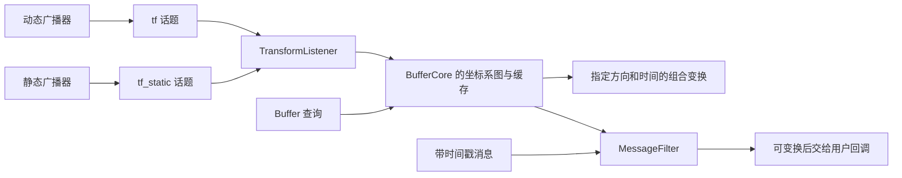

# 第 21 章 TF2：变换缓存、查询与消息接入

一条带 frame_id 的消息要用于另一个坐标系，必须知道两个坐标系在指定时间的变换。TF2 把变换存入带时间的图，再在查询时组合边。本章要区分“变换话题存在”“缓存中有某条边”和“所需时刻可以完成查询”。

> 状态：初稿，关键路径按本地 `ros2/geometry2` 源码核验；实验待执行。版本见 [附录 A](appendix-a-source-baseline.md)。前置知识为话题、执行器和时钟。

## 21.1 BufferCore 与 ROS 接入层



BufferCore 管理图和时间缓存；tf2_ros 提供话题接入、ROS 时间等待和消息过滤。缓存不是 DDS 缓存，MessageFilter 也不是中间件订阅历史深度。

| 文件与符号 | 阅读目标 |
| --- | --- |
| [`buffer_core.cpp`](../../src/ros2/geometry2/tf2/src/buffer_core.cpp)，`setTransform`、`lookupTransform`、`walkToTopParent` | 插入检查、时间查询和路径组合 |
| [`cache.cpp`](../../src/ros2/geometry2/tf2/src/cache.cpp)，`TimeCache` | 动态变换时间缓存 |
| [`transform_listener.hpp`](../../src/ros2/geometry2/tf2_ros/include/tf2_ros/transform_listener.hpp)，`TransformListener` | 订阅、回调组与可选专用线程 |
| [`buffer.cpp`](../../src/ros2/geometry2/tf2_ros/src/buffer.cpp)，`Buffer` | 超时等待与 ROS 时钟 |
| [`message_filter.hpp`](../../src/ros2/geometry2/tf2_ros/include/tf2_ros/message_filter.hpp)，`MessageFilter` | 等待消息所需的变换 |

## 21.2 查询方向必须先说明

核心 API `lookupTransform(target, source, time)` 返回把 source 坐标表示变成 target 坐标表示所需的变换。父子关系、矩阵方向和工具参数名容易混淆，阅读时应先写出“把哪一系的点转到哪一系”。

本地 `tf2_echo` 的命令行帮助使用 source_frame、target_frame 字样，但实际将第一个参数传给 API 的 target 位置。下面实验直接按源码调用方向解释，不仅凭工具变量名判断正负。

图中边有方向，但查询可以沿树走到共同祖先，再按方向组合或求逆。缺少坐标系、图不连通和时间外推是不同错误：名称不存在要查命名与接收；不连通要查拓扑；外推要查时间与缓存范围。

## 21.3 最新时间不是任意历史时间

动态变换保存有限时间窗口。请求太早或太晚都可能外推失败。时间零通常表示查询可用的最新关系，多条边仍要找到相容的时间，不能把各边任意最新值拼成一个没有共同时间含义的结果。

静态变换用不同缓存语义表达不随时间变化的关系，通常通过带 transient-local durability 的静态话题让晚加入者接收。它和“动态广播器只发过一次”并不等价。

带 header.stamp 的业务消息应在其采样时间做变换；使用最新变换会改变空间解释，在运动平台上可能引入误差。系统时间、仿真时间和录制回放时间需要统一核对。

## 21.4 等待依赖监听端仍能运行

TransformListener 可以使用专用执行器线程，也可以由应用负责推进监听回调。源码在启用 spin_thread 时创建执行器、分配监听回调组，并标记 Buffer 使用专用线程。

如果在唯一执行器线程内等待一个尚未接收的变换，而接收 TF 也依赖同一线程，就可能等到超时。超时参数不是额外线程；应核对监听线程和回调组。MessageFilter 把“暂时还不能变换”的消息延后交付，减少这种同步等待，但它有队列限制，不能无限积压。

## 21.5 实验：静态边、逆向查询与断开边

Ubuntu、Bash，各终端先执行：

```bash
source /path/to/ros2_source_code/install/setup.bash
export ROS_DOMAIN_ID=42
export RMW_IMPLEMENTATION=rmw_fastrtps_cpp
mkdir -p experiment-results
```

终端 A：

```bash
ros2 run tf2_ros static_transform_publisher --x 1 --y 0 --z 0 --yaw 0 --pitch 0 --roll 0 --frame-id book_world --child-frame-id book_sensor
```

终端 B，等待发现后观察数次输出，再按 Ctrl+C：

```bash
ros2 run tf2_ros tf2_echo book_world book_sensor 2>&1 | tee experiment-results/ch21-forward.log
```

```bash
ros2 run tf2_ros tf2_echo book_sensor book_world 2>&1 | tee experiment-results/ch21-inverse.log
```

预期而非实测：第一次查询的平移为 x=1，逆向为 x=-1，旋转为单位旋转。该设置没有旋转，因此逆向平移易于核对；一般带旋转时不能只把每个平移分量直接取负。

再查询 `book_world` 与不存在的 `book_missing`，预期报告无法取得变换，数秒后 Ctrl+C。它验证的是缺失坐标系，不是时间外推。静态例子也不能验证动态插值或缓存过期。

| 实验 | 状态 | 实际观察与证据 |
| --- | --- | --- |
| 静态边与逆向查询 | 待执行 | 待填写；`experiment-results/ch21-*.log` |
| 缺失坐标系 | 待执行 | 待填写；错误输出待保存 |

## 21.6 本章小结

TF2 查询同时受图连通性、方向、时间和监听调度约束。存在 TF 话题不能替代一次指定时刻的成功查询。下一章把名称、QoS、调度和源码证据组织为完整排障过程。

审校记录：查询方向、监听线程与缓存入口已核对；运行数值、动态时间和 MessageFilter 行为待验证。
