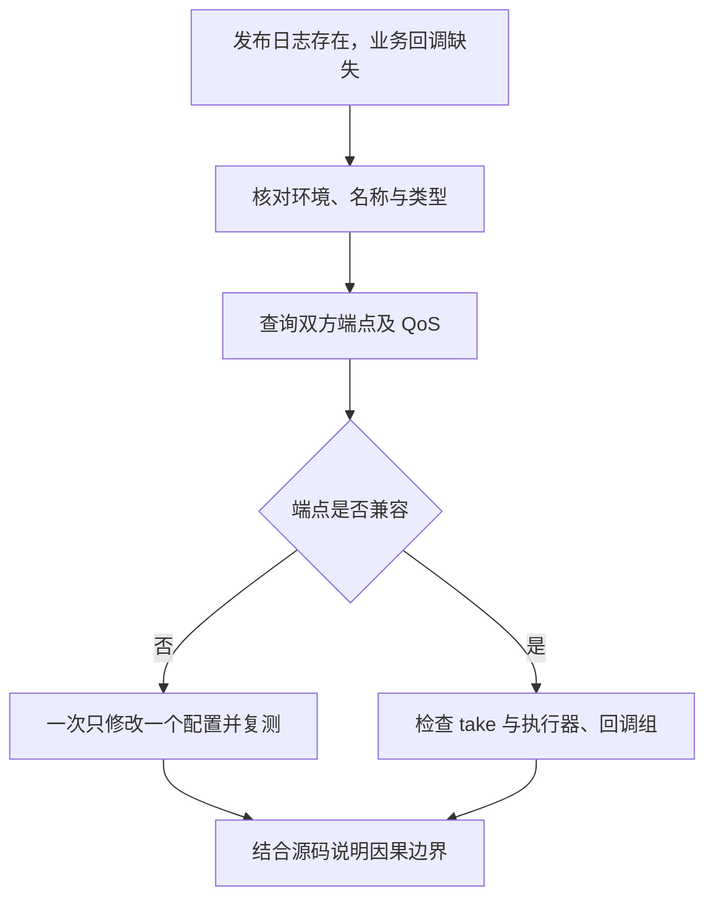

# 第 22 章 一次完整排障：从现象、实验到源码证据

“发布者在打印，订阅者没有回调”是一条现象描述，还不是故障原因。它可能涉及不同名称、未发现、QoS 不匹配、消息尚未取出或回调没有调度。本章用本书已有 QoS 探针建立可控故障，再把每一步结论限制在它真正支持的范围内。

> 状态：案例初稿，源码判断已核对；实验待执行，没有预填实际故障日志。环境为 Ubuntu、Bash、本书固定源码环境、跨进程通信、rmw_fastrtps_cpp。版本见 [附录 A](appendix-a-source-baseline.md)。

## 22.1 先记录对象与环境

排障记录应包含系统、节点所在进程、完全限定名称、类型、域、RMW、实际端点 QoS 和开始时间。应用说自己调用了 publish，只能证明进入或返回了某个代码位置；它不证明另一个进程收到数据。



这是一条适用于本案例的取证路径。实际系统若没有端点，应先解释创建或发现问题，不要跳到线程死锁结论。

## 22.2 建立可控故障

探针见 [`experiments/qos/main.cpp`](../../experiments/qos/main.cpp)。它显式关闭进程内通信与辅助接口，设置可靠性和持久性，打印发布返回和接收计数。发布端连续发送约 10 秒，随后保持端点约 15 秒；接收端运行约 10 秒。

仓库根目录，Ubuntu、Bash，各终端加载环境：

```bash
source /path/to/ros2_source_code/install/setup.bash
export ROS_DOMAIN_ID=42
export RMW_IMPLEMENTATION=rmw_fastrtps_cpp
mkdir -p experiment-results
cmake -S experiments/qos -B build/qos -DCMAKE_BUILD_TYPE=Debug
cmake --build build/qos
```

终端 A：

```bash
./build/qos/qos_probe pub best-effort volatile 2>&1 | tee experiment-results/ch22-pub.log
```

迅速在终端 B：

```bash
./build/qos/qos_probe sub reliable volatile 2>&1 | tee experiment-results/ch22-sub-incompatible.log
```

在接收端运行期间，终端 C：

```bash
ros2 topic info /qos_probe -v 2>&1 | tee experiment-results/ch22-endpoints.log
```

预期而非实测：图中存在 String 发布与订阅端点，发布端为 best-effort，订阅端请求 reliable，接收计数为 0。CLI 查询必须赶在接收进程结束前；查询只看到发布端时应重跑，不把缺失的快照补成双端点证据。

## 22.3 把端点事实连接到匹配规则

第 7 章已经说明可靠性采用 offered/requested 兼容关系：best-effort 发布者不满足 reliable 订阅者请求。可以沿以下入口复核配置如何落到 RMW：

| 路径 | 需要核对的事实 |
| --- | --- |
| [`qos.hpp`](../../src/ros2/rclcpp/rclcpp/include/rclcpp/qos.hpp)，`QoS` | 显式配置转换为 rmw QoS profile |
| [`subscription.c`](../../src/ros2/rcl/rcl/src/rcl/subscription.c)，`rcl_subscription_init` | 订阅选项传递到 RMW |
| [`publisher.cpp`](../../src/ros2/rmw_fastrtps/rmw_fastrtps_cpp/src/publisher.cpp) 与 [`subscription.cpp`](../../src/ros2/rmw_fastrtps/rmw_fastrtps_cpp/src/subscription.cpp) | 具体实现创建端点 |
| [`executor.cpp`](../../src/ros2/rclcpp/rclcpp/src/rclcpp/executor.cpp)，`execute_subscription` | 数据取出并进入业务处理的后半段 |

这些入口分别解释配置、端点和调度，不把某一个 C++ 分支称为所有 DDS 实现唯一的匹配判断位置。当前案例的归因需要“实际端点不兼容”和“单变量调整后恢复”共同支持。

## 22.4 只改变订阅可靠性

重新运行相同发布端，在终端 B 只改 reliable 为 best-effort：

```bash
./build/qos/qos_probe sub best-effort volatile 2>&1 | tee experiment-results/ch22-sub-compatible.log
```

预期而非实测：接收计数非零，消息带 `sample:` 序号。保持相同域、话题、类型和 RMW。不要同时改变可靠性、持久性和名称，否则恢复通信仍无法区分是哪一项起作用。

收不到时应先确认两端运行时间重叠且发布端仍处于发送阶段。该探针的 volatile 发布端在保持阶段不再发送；此时晚启动接收端即使兼容也可能计数为零。

## 22.5 若兼容后仍没有业务回调

接下来再区分传输与调度。可用显式 best-effort、volatile 的 CLI echo 验证工具订阅是否收到新消息；收到只证明工具这一条路径。业务进程中应检查是否推进执行器、实体是否属于已加入的节点/组，以及长回调是否占据执行资源。

需要调试器时，在带符号且与本书版本一致的二进制上设置 `rcl_take`、`Executor::execute_subscription` 和业务回调源码行断点，保存线程栈。GDB all-stop 会人为暂停整个订阅进程，导致积压或丢失；要把断点影响列入记录。take 返回无数据与回调组无法获调度是两个阶段，不能混为一个故障。

本章没有运行该调度分支实验，因此不宣称任何现有程序发生死锁。

## 22.6 形成可复核的故障报告

| 项目 | 本案例记录 |
| --- | --- |
| 状态 | 待执行 |
| 现象 | 预期：publish 返回，reliable 接收端计数为 0 |
| 环境与端点 | 待保存系统、域、RMW、两端进程与 QoS 快照 |
| 单变量变更 | 订阅 reliable 改为 best-effort |
| 实际结果 | 待填写，不能用预期替代 |
| 证据 | `experiment-results/ch22-*.log`，匹配版本源码入口 |
| 结论边界 | 只验证所选实现和配置下的可靠性兼容性，不评价丢失率与性能 |

## 22.7 全书收束

前文建立了从初始化、接口生成、端点创建到等待、调度和消息所有权的主线；服务、Action、参数、生命周期和组件把它扩展成更完整的节点协作模型。launch、CLI、rosbag2 与 TF2 展示同一组机制在工程工具中的组合。

源码阅读的成果，应是能够设计实验、识别证据层次并限定结论。本文的初稿还需要在匹配环境下执行实验并审校；附录保存版本、入口、实验状态和术语，让后续核验能继续沿同一基线推进。

审校记录：可控 QoS 故障、单变量对照和源码入口已核对；故障复现、恢复与证据报告待运行完成。
